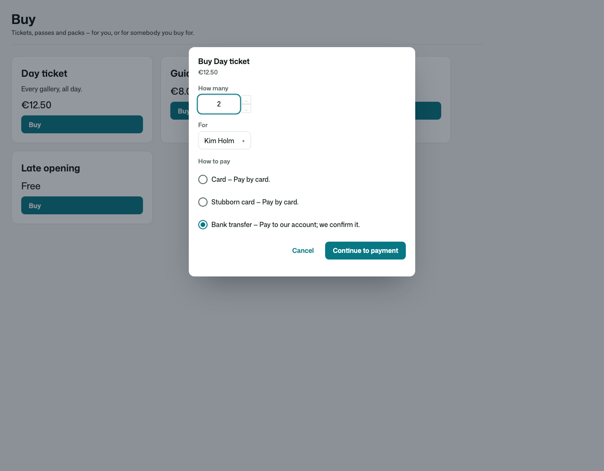
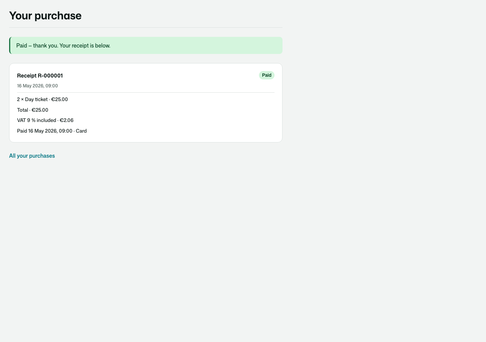
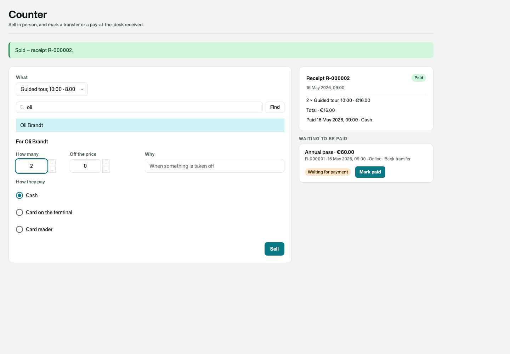
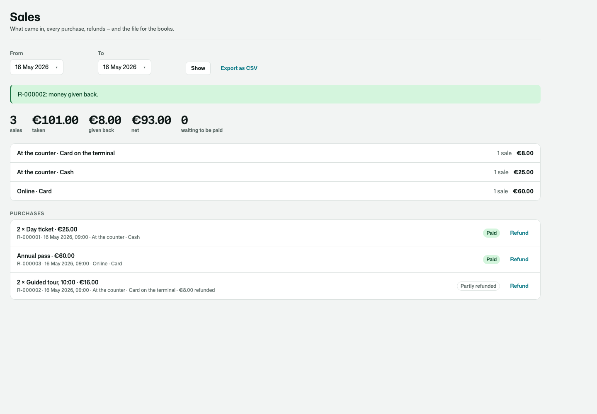
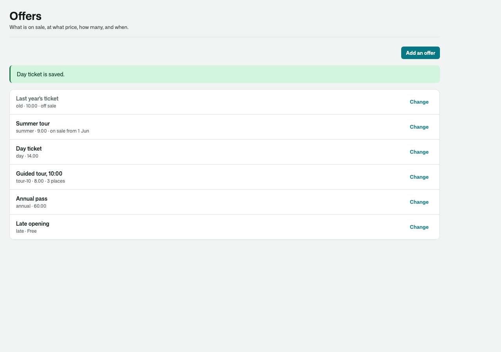
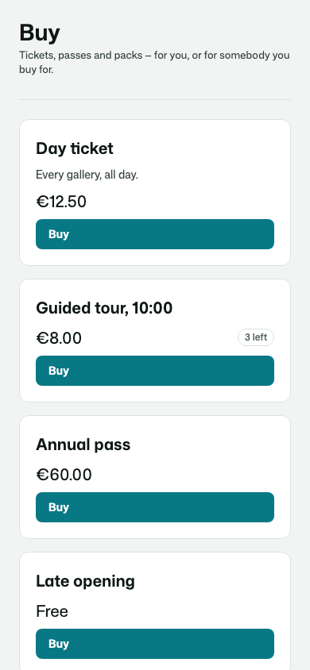
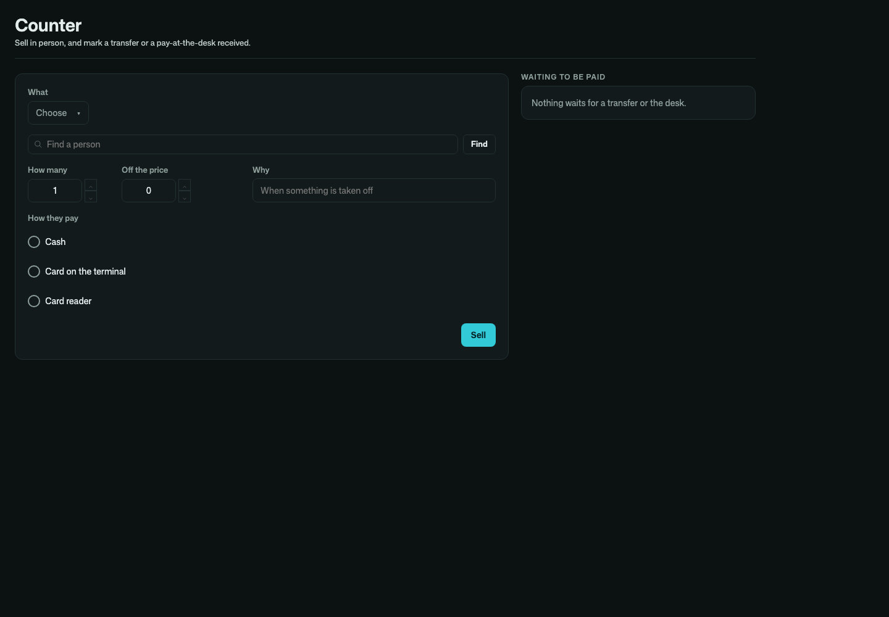

# Osysharp.OfferSales

**Sell a few simple offers, online or across a counter.** A day ticket, a guided tour with a few places, a ten-visit
card, a monthly membership, a workshop seat — for a museum, a pool, a studio, a school, a venue, a club. Not a shop:
nothing is shipped and there is no catalogue. It is the small thing beside an app that sells a handful of fixed-price
offers to the people it already knows, and hands over what they bought.

- **Offers** you set up — a price (tax included, with its rate), on sale or not, a sale window, a number of
  **places** that cannot be oversold even when two people race for the last one, a **per-person limit**, a most-at-once.
  An app adds its own kinds (`entity GuidedTour : Offer { … }`).
- **Online through any payment provider** (Osysharp.Payments — Stripe, Klarna, Swish, your own): the buyer is sent to
  the provider and back; only the provider's own word, for this amount, makes it paid — from the buyer's return or
  from the provider's signed event, whichever comes first.
- **By transfer or pay-at-the-desk**: the buyer gets the instructions, staff mark it received.
- **At the counter**: money in hand (cash, a card terminal this app does not run), or a provider's device — a card
  reader, a QR code the customer scans — asked until it is paid. A discount takes a reason, which is kept.
- **For somebody else**: a parent buys for a child (the app says who may buy for whom, and who to offer).
- **Every purchase is a record**: a receipt number, what was paid for whom, how; held while it is paid and **lapsing**
  when it is not, its places back on sale.
- **Told once**: `PurchasePaid` exactly once however the money arrived and however often it is reported;
  `PurchaseRefunded` once per refund, with `Whole` when all of it is back.
- **Refunds**, whole or in part, through the provider that took the money (a reader's payment through its online
  provider), or by hand for cash — recorded before the provider is asked, so two at once cannot both ask.
- **The takings** for a day or a period by channel and method — taken, given back, net — and a **CSV** for the books.

With [Osysharp.PrepaidCredits](https://github.com/osysharp) or [Osysharp.Memberships](https://github.com/osysharp) in the
app, a credit pack or a membership plan is an offer of its own, granted to whoever it was bought for once paid and
taken back on a whole refund — by itself (`Osysharp.OfferSales.PrepaidCredits`, `Osysharp.OfferSales.Memberships`).

| Buying, for a child, by transfer | Back from the card provider |
|---|---|
|  |  |

| The counter | The takings, and a part refund |
|---|---|
|  |  |

| The offers | On a phone · in the dark |
|---|---|
|  |   |

## Use it

```osy
// app.osy
use Osysharp.Identity@0;
use Osysharp.Payments@0;
use Osysharp.Payments.Stripe@0 { egress "api.stripe.com"; }   // a provider, when you want one
use Osysharp.OfferSales@1;
```

```osy
using Osysharp.Identity;
using Osysharp.Payments;
using Osysharp.OfferSales;

policy ManagesOffers => IsManager;        // offers and prices, the takings
policy SellsAtCounter => IsDesk;          // sell in person, mark a transfer received
policy RefundsPurchases => IsManager;     // give money back (whoever manages offers, unless you say otherwise)
policy BuysFor(Principal holder) => holder == user || ActsForDependant(holder);   // a parent for a child

app.OfferSales = new OfferSalesSetup {
  Providers = [ new StripePayments { ApiKey = Secret.StripeApiKey, WebhookSecret = Secret.StripeWebhookSecret },
                new ManualPayment { Key = "desk", Label = "Pay at the desk" } ],
  CounterMethods = ["Cash", "Card on the terminal"],
  Currency = "EUR", Seller = "Harbour Museum",
};

// Hand over what was bought — once:
[On] void HandOver(PurchasePaid e) { /* a ticket for e.Purchase.For */ }
[On] void TakeBack(PurchaseRefunded e) { if (e.Whole) { /* void it */ } }
```

A provider's events reach `OfferSalesPaymentEvents(provider)` at a route the app declares, as with Osysharp.Shop:
`new RestApi("Payments") { Route = "payments", Auth = new ApiAuth { Anonymous = true }, Endpoints = [ new
Endpoint(OfferSalesPaymentEvents) { Method = HttpMethod.Post, Path = "/{provider}/events", Raw = true, Headers =
["Stripe-Signature"] } ] }`.

From code: `OffersOnSale`, `OfferRefusal`, `PlacesLeft`, `PaymentChoices`, `OfferSalesRecipients`, `StartPurchase`,
`ConfirmPurchase`, `ApplyOfferSalesEvents`, `MarkPurchasePaid`, `CancelPurchase`, `SellAtCounter`,
`StartCounterPurchase`, `CheckCounterPurchase`, `RefundPurchase`, `RefundableOf`, `MyPurchases`, `PurchasesBetween`,
`TakingsBetween`, `PurchasesCsv`. Events: `PurchasePaid`, `PurchaseFailed`, `PurchaseCancelled`, `PurchaseRefunded`.

## Pages

`/buy`, `/purchases` (with each receipt), `/purchases/{reference}/{token}` (where a provider sends the buyer back),
`/staff/counter`, `/staff/sales` and `/staff/offers` are served in the app's working shell, in its theme. Take one over
by declaring a component of the same name, or place `BuyOffers`, `OfferPriceList` (a public price list for a landing
page), `MyPurchases`, `PurchaseReceipt`, `CounterSale`, `SalesDesk` or `OffersDesk` on a page of your own.

## Personal data

In an app with Osysharp.Privacy, Osysharp.Privacy.OfferSales arrives by itself: what a person bought or had bought for
them is in their copy of their data, kept with the books for as long as bookkeeping law asks, and erased when that ends.

## What informed it

- **Stripe Payment Links and Checkout** — a fixed-price item with a quantity cap, limited inventory, the buyer sent to
  the provider and back, paid confirmed by the provider and its webhook.
- **Square Point of Sale** — sales at a counter by cash or card reader, partial refunds, and an end-of-day sales
  summary by payment method with refunds netted out.
- **Mindbody and Glofox** — passes and packs sold at the front desk or online, for a family member, and granted the
  moment they are paid.

## Source

[github.com/osysharp/offersales](https://github.com/osysharp/offersales). Its tests (`tests/`) are a small museum's: every
behaviour above, each seam shown, the rules proved as each person, and the pages under `osy test --pixels`.
